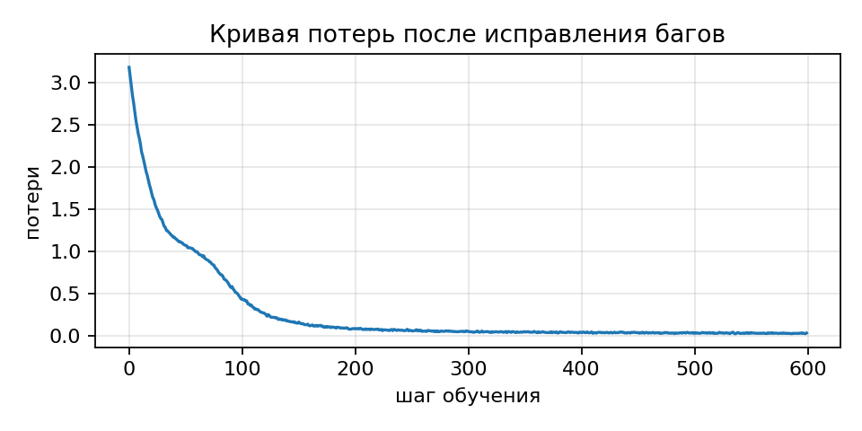

# Мультимодальная обработка данных

Практические задания по курсу, УрФУ.

## Практическое задание № 1. Внимание своими руками

Вариант поиска ошибок: **seed 42**. Реализованы четыре функции внимания и блока трансформера, исправлены три ошибки, выполнено обучение на учебном корпусе.

### Файлы

- [Ноутбук с реализацией](practical_assignment_1/practical_assignment_1_attention.ipynb) - четыре функции и проверки.
- [Поиск ошибок и обучение](practical_assignment_1/practical_assignment_1_bughunt.ipynb) - исправления, таблица ошибок, график и генерация.
- [Отчёт](practical_assignment_1/report.pdf).
- [Результаты запусков](practical_assignment_1/results/) - журналы, конфигурация, значения потерь и пример текста.

### Запуск в Google Colab

1. Загрузить `practical_assignment_1/practical_assignment_1_attention.ipynb` через «Файл → Загрузить блокнот».
2. Выполнить все ячейки сверху вниз. В конце должно быть **17 из 17** проверок.
3. Отдельно открыть `practical_assignment_1/practical_assignment_1_bughunt.ipynb`. Выбрать среду с GPU T4: это требование условия для итоговой проверки. CPU поддерживается для локальной отладки.
4. Выполнить все ячейки сверху вниз. После 17 успешных проверок начнётся обучение на 600 шагов.
5. Сохранить выполненный ноутбук. Дополнительные результаты создаются в папке `results` текущей среды; их можно скачать через панель файлов Colab.

Ноутбуки самостоятельны: переносить определения из первого во второй не нужно. Данные заданы строкой внутри второго ноутбука, скачивание датасета или весов не требуется. В Colab PyTorch и Matplotlib обычно уже установлены. Первая ячейка при необходимости устанавливает PyTorch.

### Локальный запуск

Проверенное окружение: Python 3.13.1, PyTorch 2.10.0+cpu, Matplotlib 3.10.7, Windows, CPU, 2 вычислительных потока.

Из корня репозитория:

```bash
python -m venv .venv
```

Активировать окружение в PowerShell:

```powershell
.venv\Scripts\Activate.ps1
```

Затем:

```bash
python -m pip install -r requirements.txt
python -m jupyterlab
```

Открыть ноутбуки из `practical_assignment_1` и выполнить каждый с чистого ядра. Относительная папка `results` создаётся рядом с ноутбуком при обычном запуске Jupyter.

### Эксперимент

| Параметр | Значение |
|---|---|
| Seed варианта ошибок | 42 |
| Seed обучения / генерации | 0 / 0 |
| Корпус | «алгоритм внимания смотрит на все позиции сразу. » × 200 |
| Токенизация | Посимвольная, отсортированный словарь из 19 символов |
| Размер модели / FFN | 128 / 512 |
| Блоки / головы | 2 / 4 |
| Контекст / батч | 64 / 32 |
| Dropout | 0.1 |
| Оптимизатор | AdamW, lr=0.0003, weight_decay=0.01 |
| Шаги | 600 |
| Параметры модели | 400640 |
| Генерация | Начало «а», 200 новых символов, temperature=0.8, top_k=10 |

Seed 42 определяет вариант ошибок, а не случайность обучения. Seeds отдельных штатных проверок оставлены как у преподавателя. Фиксация seed не гарантирует побитового совпадения между CPU и GPU или разными версиями библиотек.

### Полученные результаты

- Первый ноутбук: **17/17** штатных проверок.
- Второй ноутбук: **7/17 до исправлений → 9/17 → 12/17 → 17/17**.
- Потери первого и последнего обучающих батчей: **3.184385 → 0.036880**.
- Основные ноутбуки и файлы `results` содержат локальный запуск на CPU. Дополнительно оба ноутбука выполнены в Google Colab с Tesla T4; выполненные версии сохранены в папке `colab` (см. ниже).



Пример генерации:

```text
ания смотрит на все позиции сразу. алгоритм внимания смотрит на все позиции сразу. алгоритм внимания смотрит на все позиции сразу. алгоритм внимания смотрит на все позиции сразу. алгоритм внимания смот
```

Потери относятся к случайным обучающим батчам с включённым dropout. Отдельной валидационной выборки в заданном эксперименте нет. Повторение шаблона показывает, что исправленная модель обучается, но не доказывает обобщение на новые тексты. Числа из PDF задания получены на другом корпусе и не служат точным порогом для этого ноутбука.

### Дополнительный запуск в Google Colab на Tesla T4

- [Часть 1: выполненный ноутбук Colab](practical_assignment_1/colab/practical_assignment_1_attention.ipynb).
- [Часть 2: проверки, обучение и график в Colab](practical_assignment_1/colab/practical_assignment_1_bughunt.ipynb).

Оба файла содержат сохранённые выводы ячеек: `Устройство: cuda`, `GPU: Tesla T4`, **17 из 17** успешных проверок. Во втором ноутбуке обучение выполнено на GPU, завершены все **600 шагов**, сохранены график и пример генерации. Итог потерь в выводе: **3.190 → 0.034** (округлённые значения). Штатные тесты создают тензоры на CPU; их успешное выполнение в среде Colab не означает, что сами тесты исполнялись на GPU.

Окружение Colab: Python **3.13.16**, PyTorch **2.11.0+cu130**, Matplotlib **3.10.0**. Код вычислений совпадает с основной версией. Различие численных результатов между CPU и GPU ожидаемо.

Основные ноутбуки, папка `results` и PDF-отчёт сохраняют исходный CPU-эксперимент. PDF также содержит сведения о подтверждённом запуске в Colab на T4 и его окружении; приведённый в PDF график относится к CPU-эксперименту. Отдельные файлы результатов GPU-запуска пока не включены: его выводы и график доступны внутри этих ноутбуков.

### Что изменено

В первом ноутбуке заполнены четыре TODO. Во втором исправлены начало отсчёта позиций, две редукции LayerNorm и ось softmax. Проверки преподавателя сохранены без изменений; после их запуска добавлен `assert`, чтобы обучение не начиналось при ошибках. Добавлены сведения об окружении, перенос модели и батчей на выбранное устройство, отдельный seed генерации и сохранение результатов. Конфигурация и 600 шагов обучения сохранены.

В таблице ошибок номера строк относятся к исходной ячейке определений модели, начиная с `from __future__ import annotations`. Файл `results/diagnostics.json` сохраняет результаты последовательных исправлений; он не пересоздаётся обычным запуском уже исправленного ноутбука.

### Проверка соответствия заданию

| Критерий | Подтверждение |
|---|---|
| Четыре функции (20 баллов) | Все четыре реализованы вручную, 17/17 исходных проверок |
| Поиск ошибок (17 баллов) | Три ошибки варианта 42: локализация, механизм и исправление в таблице |
| Обучение (5 баллов) | 600 шагов из исходного ноутбука, график и пример текста сохранены |
| Отчёт и воспроизводимость (8 баллов) | PDF, README, seeds, конфигурация и зависимости |
| Среда Colab T4 | Подтверждена выполненными ноутбуками в папке `colab`: CUDA, Tesla T4, 17/17 проверок в каждом, завершённое обучение |

Связь с материалами курса: вебинар 3-4, слайды 31, 68, 81 и 87 (ось softmax, масштабирование, маска, dropout); вебинар 5-6, слайды 49 и 75 (сборка голов и LayerNorm); вебинар 7, слайд 10 (pre-norm). В ноутбуке вебинара 7-8 используется тот же порядок нормализации и остаточных связей. Сохранена именно архитектура задания: синусоидальные позиции и заданное размещение dropout; детали полной GPT-2 из лекций не добавлялись.

В исходном примере пояснения ошибки перепутано действие деления на `d_k`. В готовом ноутбуке добавлено уточнение: оно уменьшает разброс логитов, а не вызывает насыщение softmax. Вариант 42 уже содержит верное масштабирование.

### Учебные материалы

Решение опирается на выданные ноутбуки практического задания, занятия 1.2-1.4 и вебинары 3-4, 5-6, 7-8: разбиение голов, причинное внимание, LayerNorm, pre-norm и цикл обучения. Материалы преподавателя целиком в репозиторий не включены.
